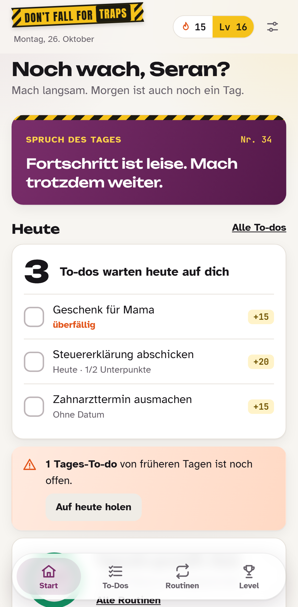
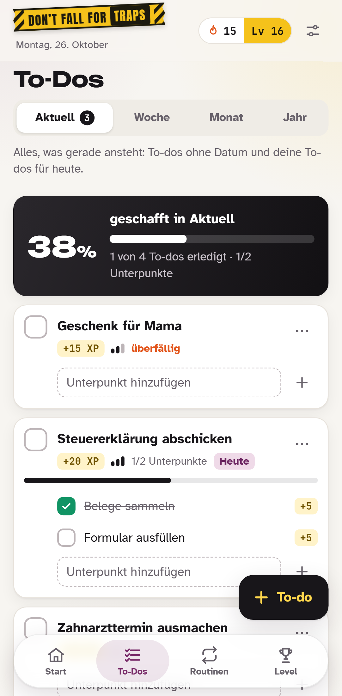
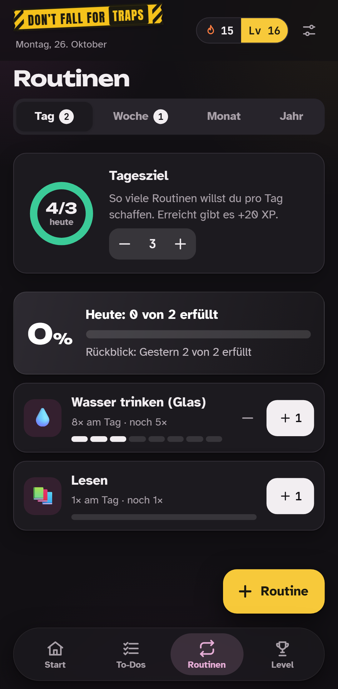
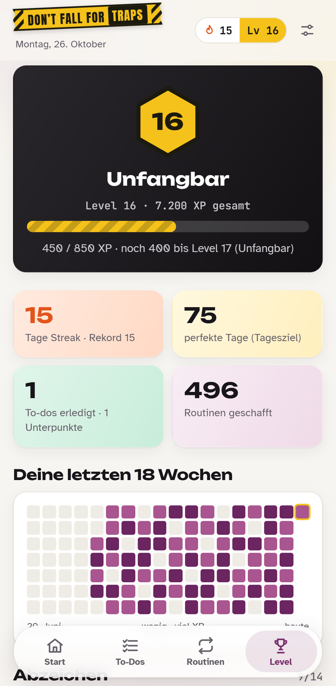

# Don't Fall for Traps

Eine stark gamifizierte App für **To-dos** und **Routinen**. Die „Fallen“ sind Aufschieben, Ausreden und „nur noch kurz“. Wer abhakt, sammelt XP, steigt im Level auf, hält eine Streak und schaltet Abzeichen frei. Auf Deutsch und Englisch.

| Start | To-Dos | Routinen (dunkel) | Level |
|---|---|---|---|
|  |  |  |  |

**Stand:** Phase 1, erster Entwurf als Web-App. Daten liegen lokal im Browser bzw. auf dem Gerät. Konto, Sync und Morgen-Mail kommen in Phase 2, die Apps für Android und iOS in Phase 3. Plan und Hintergründe: [docs/ENTSCHEIDUNG-STACK.md](docs/ENTSCHEIDUNG-STACK.md).

## Starten

Voraussetzung: Node.js 22 oder neuer.

```bash
npm install
npm run web          # Entwicklungsserver im Browser
```

Statische Web-Version so bauen und ansehen, wie sie auf GitHub Pages läuft:

```bash
npm run export:web   # schreibt nach dist/
npm run serve:web    # http://localhost:8090/dont-fall-for-traps/
```

## Prüfen

```bash
npm run verify       # Sprachdateien vollständig? Typen ok? Unit-Tests grün?
npm run test:e2e     # Ablauf im Browser (vorher: npm run export:web, einmalig: npx playwright install chromium)
```

- `src/game/` enthält die reine Spiellogik (XP, Level, Streak, Abzeichen, Hinweise, ISO-Wochen) ohne UI. Ein Test vergleicht sie mit der Berechnung aus dem Prototyp.
- `npm run check:locales` lässt den Build scheitern, wenn in `locales/de.json` und `locales/en.json` Schlüssel fehlen oder der Code einen unbekannten Schlüssel benutzt.

## Veröffentlichen (GitHub Pages)

Jeder Push auf `main` startet `.github/workflows/pages.yml`: Prüfungen, statischer Export mit Unterpfad `/dont-fall-for-traps` (`experiments.baseUrl` in `app.json`), Veröffentlichung auf GitHub Pages.

Einmalig im Repo: **Settings → Pages → Source: GitHub Actions**. Danach läuft die Seite unter `https://<github-name>.github.io/dont-fall-for-traps/`.

## Aufs iPhone (bis zur echten App)

Seite in Safari öffnen → **Teilen** → **Zum Home-Bildschirm**. Die App startet dann ohne Browserleiste mit eigenem Icon. Auf Android geht das in Chrome über **⋮ → Zum Startbildschirm hinzufügen**.

## Daten aus dem Prototyp übernehmen

Einstellungen (Regler-Symbol oben rechts) → **Daten importieren**: JSON-Datei wählen oder den Inhalt einfügen. Erwartet wird das Format `{ settings, todos, routines, days }` wie im Prototyp. Fehlt `language`, gilt „System“. **Daten exportieren** erzeugt eine Sicherung im selben Format.

## Aufbau

```
src/app/            Routen (Expo Router): Start, To-Dos, Routinen, Level
src/features/       Bildschirme, Formulare, Einstellungen
src/game/           Spiellogik ohne UI (auch für die Mail-Funktion in Phase 2)
src/data/           lokaler Speicher (Web: IndexedDB, Apps: SQLite), Import/Export
src/theme/          Design-Tokens aus dem Prototyp (hell/dunkel)
src/ui/             Bausteine: Absperrband, Glas-Leisten, Ring, Heatmap, Konfetti, Toasts
locales/            de.json, en.json (alle sichtbaren Texte)
scripts/            Sprachprüfung, Icons (npm run icons), Screenshots, lokaler Pages-Server
e2e/                Playwright-Test
```

Technik: Expo SDK 58 (React Native + react-native-web), TypeScript, Expo Router, i18next, Reanimated, react-native-svg.

---

## English

**Don't Fall for Traps** turns to-dos and routines into a game: earn XP, level up, keep a streak, unlock badges. Available in German and English.

- Run locally: `npm install`, then `npm run web`.
- Checks: `npm run verify` (locale keys, types, unit tests) and `npm run test:e2e` (browser flow).
- Every push to `main` deploys the web version to GitHub Pages via `.github/workflows/pages.yml` (enable *Settings → Pages → Source: GitHub Actions* once).
- iPhone before the native app: open the page in Safari → Share → *Add to Home Screen*.
- Status: phase 1 (local-first web draft). Accounts, sync and the morning email follow in phase 2; Android and iOS apps from the same codebase in phase 3.
