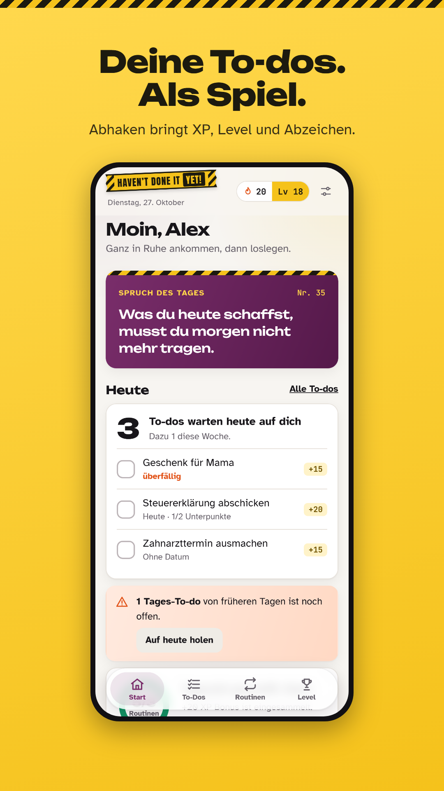
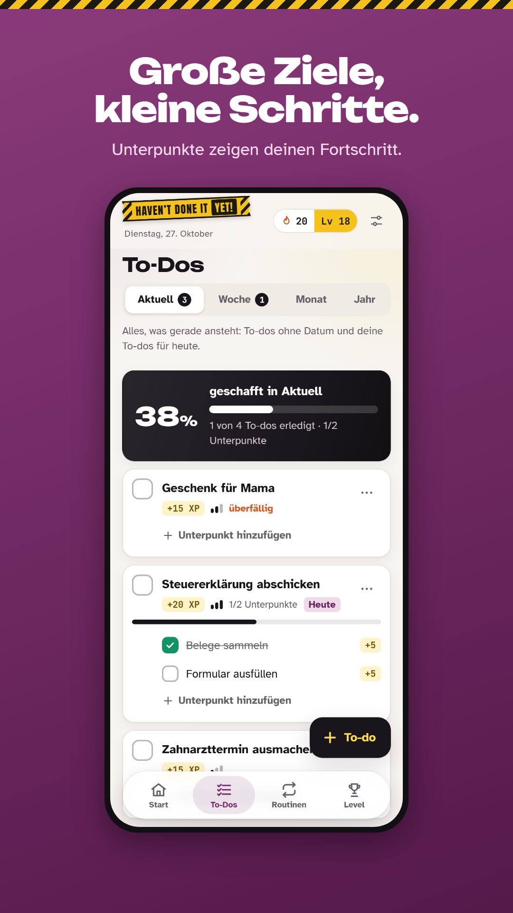
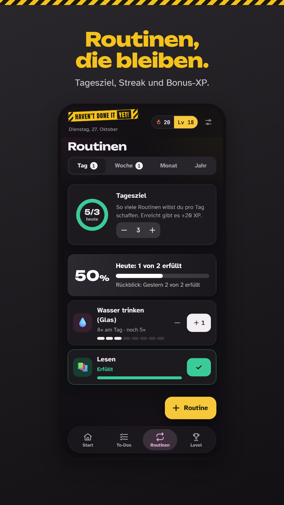
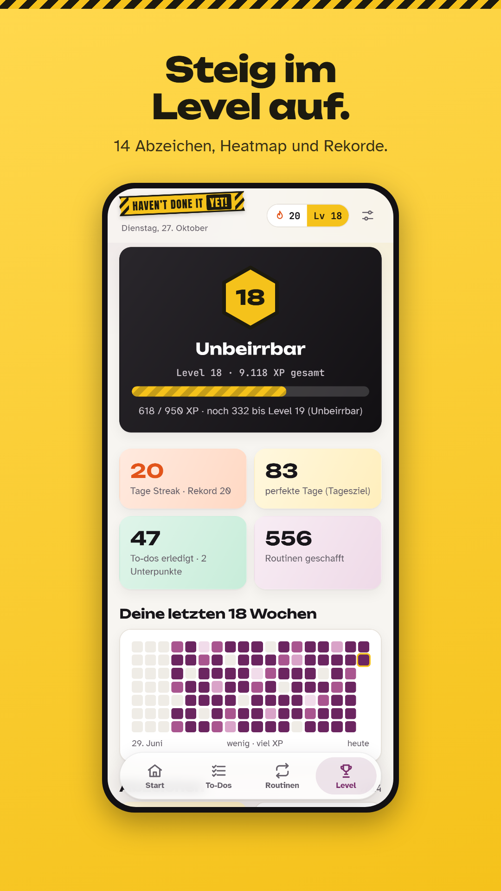

# Haven't Done It Yet!

Eine stark gamifizierte App für **To-dos** und **Routinen**. Wer abhakt, sammelt XP, steigt im Level auf, hält eine Streak und schaltet Abzeichen frei. Ohne Konto, ohne Werbung, auf Deutsch und Englisch. Läuft als Web-App sowie als App für Android und iOS aus einer Codebasis.

| | | | |
|---|---|---|---|
|  |  |  |  |

**Web-Version:** https://seran2409.github.io/havent-done-it-yet/

## Leitfäden

| Dokument | Inhalt |
|---|---|
| [docs/VEROEFFENTLICHEN.md](docs/VEROEFFENTLICHEN.md) | Schritt für Schritt in App Store und Google Play, komplett von Windows aus |
| [docs/store/STORE-TEXTE.md](docs/store/STORE-TEXTE.md) | Name, Untertitel, Beschreibung, Schlüsselwörter, Datenschutz-Angaben (DE/EN) |
| [docs/MONETARISIERUNG.md](docs/MONETARISIERUNG.md) | Pro-Version, faire Werbung, Rechenbeispiel, was vor dem ersten Euro zu tun ist |
| [docs/PROMOTION.md](docs/PROMOTION.md) | ASO, Social-Media-Formate, Communities, Zeitplan bis Januar |
| [docs/ENTSCHEIDUNG-STACK.md](docs/ENTSCHEIDUNG-STACK.md) | Warum Expo, Konten und Kosten, Erkenntnisse |

## Starten

Voraussetzung: Node.js 22 oder neuer. **Den Projektordner nicht in OneDrive ablegen**; OneDrive macht aus `node_modules` Cloud-Platzhalter, an denen der Bundler scheitert.

```bash
npm install
npm run web
```

Auf dem Handy mit Expo Go: `npx expo start` und den QR-Code scannen. Erinnerungen und den echten App-Namen gibt es erst im Build (siehe Leitfaden).

## Prüfen

```bash
npm run verify       # Sprachdateien, Typen, Unit-Tests
npm run export:web   # statischer Web-Export nach dist/
npm run test:e2e     # Browser-Ablauf (einmalig: npx playwright install chromium)
```

## Rechtstexte, Icons, Store-Grafiken

```bash
npm run legal        # Datenschutz, AGB, Impressum, Hilfe (DE/EN) aus legal.config.json
npm run icons        # App-Icon, Splash, Benachrichtigungs-Icon, Web-Icons
node scripts/store-assets.mjs http://localhost:8090/havent-done-it-yet/   # Store-Screenshots (vorher: npm run serve:web)
```

Trage vor der Veröffentlichung Name, Anschrift und Kontakt in `legal.config.json` ein. Offene Platzhalter erscheinen auf den Seiten gelb.

## Aufbau

```
src/app/            Routen (Expo Router): Start, To-Dos, Routinen, Level
src/features/       Bildschirme, Formulare, Einstellungen, Willkommen, Erinnerungen
src/game/           Spiellogik ohne UI: XP, Level, Streak, Abzeichen, Hinweise, Erinnerungsplan
src/data/           lokaler Speicher (Web: IndexedDB, Apps: SQLite), Import/Export
src/notifications/  lokale Erinnerungen (Android/iOS)
src/theme/, src/ui/ Design-Tokens und Bausteine
locales/            de.json, en.json; native/ für den Namen auf dem Home-Bildschirm
public/legal/       Rechtstexte (erzeugt)
docs/store/         Store-Texte, Screenshots, Feature-Grafiken
```

Technik: Expo SDK 58 (React Native + react-native-web), TypeScript, Expo Router, i18next, Reanimated, react-native-svg, expo-notifications, EAS Build.

---

## English

**Haven't Done It Yet!** turns to-dos and routines into a game: earn XP, level up, keep a streak, unlock badges. No account, no ads, German and English. One codebase for web, Android and iOS.

- Run: `npm install`, then `npm run web` (keep the project folder out of OneDrive).
- Checks: `npm run verify`, `npm run test:e2e`.
- Release from Windows with EAS Build and EAS Submit: see [docs/VEROEFFENTLICHEN.md](docs/VEROEFFENTLICHEN.md).
- Store texts in both languages: [docs/store/STORE-TEXTE.md](docs/store/STORE-TEXTE.md).
